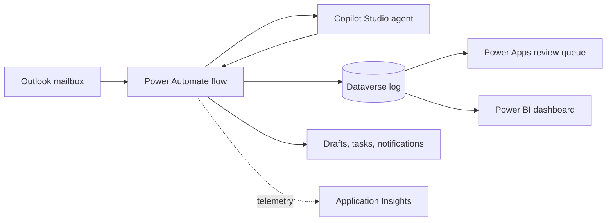

# Architecture

<!-- TODO: add a diagram (draw.io or Mermaid) -->

## Data flow
1. New email triggers the flow.
2. The agent classifies and drafts; output is validated.
3. Result is logged to Dataverse; a draft reply is created (never sent).
4. Low-confidence items go to the review queue.

## Environments
Dev (unmanaged, authoring) -> Test (managed, automated tests) -> Prod (managed, approval gate).
